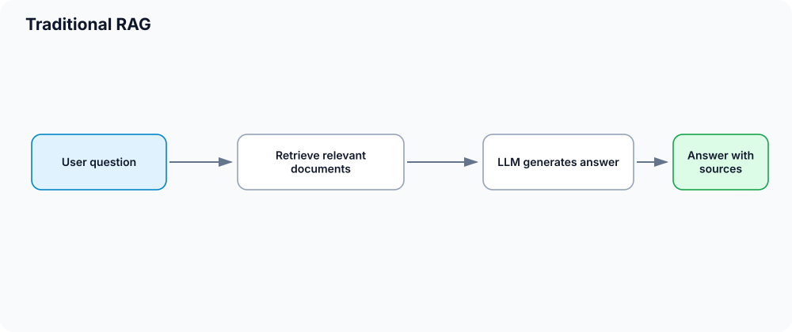
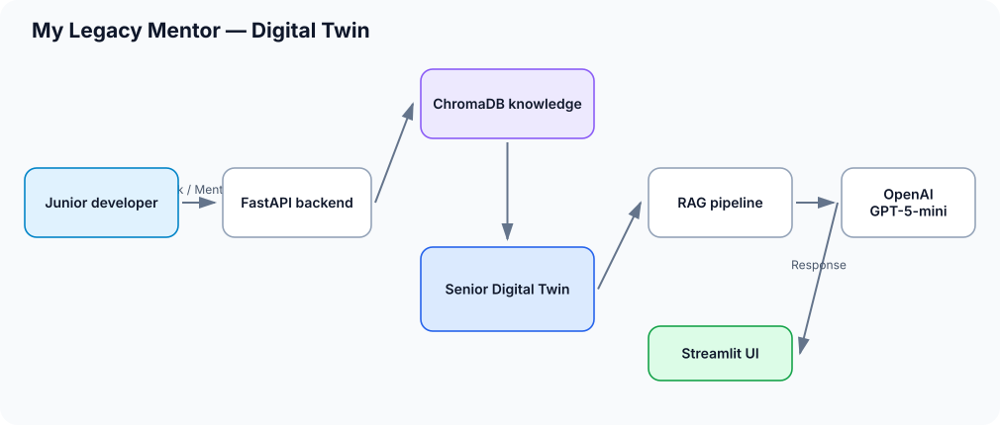
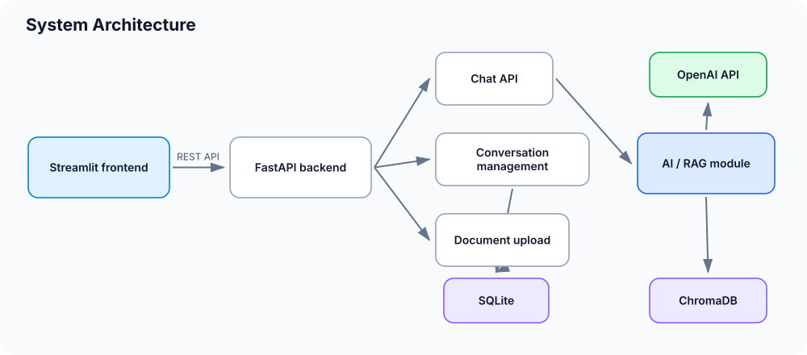
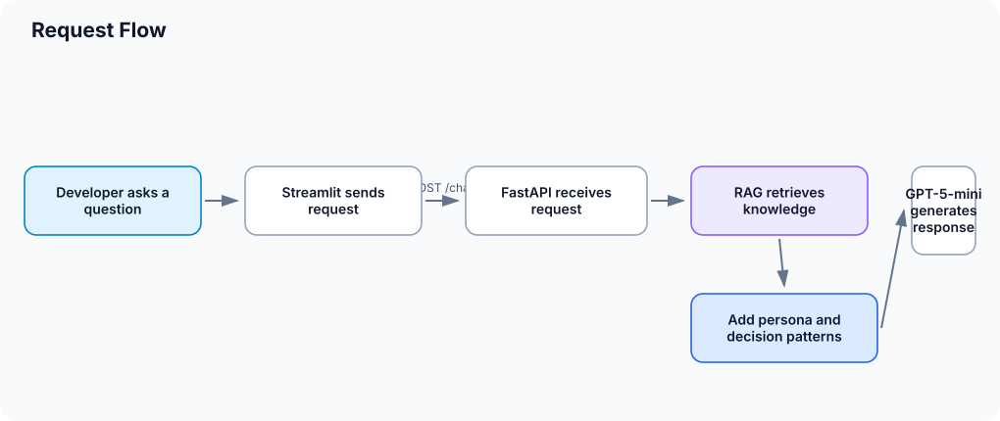
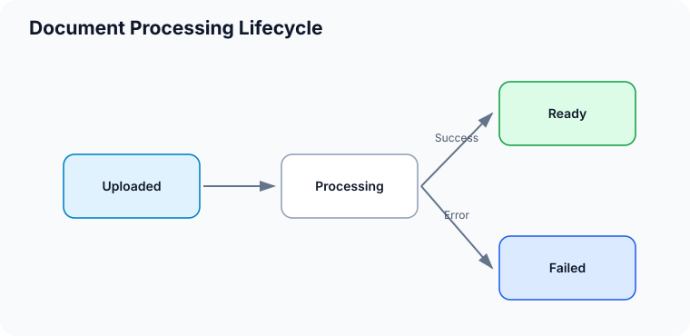

# My Legacy Mentor — AI Senior Digital Twin

### Preserving not just what Senior Engineers know, but how they think, decide, and mentor.

**My Legacy Mentor** is an AI-powered **Senior Software Engineer Digital Twin**, developed by **Team HuAltF4** for the **Netcompany Hackathon Athens 2026**.

When experienced engineers leave an organization, they take more than technical knowledge with them. They take years of engineering judgment, architectural reasoning, lessons learned from incidents, decision-making principles, and mentoring experience.

Traditional documentation can preserve what happened, but it often fails to capture **why decisions were made, which alternatives were considered, how risks were evaluated, and how experienced engineers approach unfamiliar problems**.

My Legacy Mentor addresses this challenge by creating an AI-powered digital representation of a Senior Software Engineer's documented professional knowledge and decision-making behavior.

Rather than acting as a generic technical chatbot, the system combines historical engineering knowledge, a structured Senior Engineer persona, extracted decision patterns, and personalized mentoring behavior.

The goal is to help junior developers continue benefiting from accumulated engineering experience, even after a senior colleague leaves the organization.

> **Our mission:** Preserve not only engineering knowledge, but the reasoning and experience behind it.

---

## Table of Contents

**How to run the project:** [7. Quick Start — Docker Compose](#7-quick-start--docker-compose) (recommended) or [9. Local Development Without Docker](#9-local-development-without-docker).

1. [What Makes My Legacy Mentor a Digital Twin?](#1-what-makes-my-legacy-mentor-a-digital-twin)
   - [1.1 Personal Engineering Knowledge](#11-personal-engineering-knowledge)
   - [1.2 Senior Engineer Persona Modeling](#12-senior-engineer-persona-modeling)
   - [1.3 Engineering Decision Patterns](#13-engineering-decision-patterns)
   - [1.4 Personalized Mentoring Behavior](#14-personalized-mentoring-behavior)
2. [Beyond Traditional RAG](#2-beyond-traditional-rag)
3. [Key Features](#3-key-features)
4. [System Architecture](#4-system-architecture)
5. [Technology Stack](#5-technology-stack)
6. [Project Structure](#6-project-structure)
7. [Quick Start — Docker Compose](#7-quick-start--docker-compose)
8. [OpenAI Configuration](#8-openai-configuration)
9. [Local Development Without Docker](#9-local-development-without-docker)
10. [REST API](#10-rest-api)
11. [Usage Examples](#11-usage-examples)
12. [Testing](#12-testing)
13. [Evaluation and Results](#13-evaluation-and-results)
14. [Troubleshooting](#14-troubleshooting)
15. [Security and Data Privacy](#15-security-and-data-privacy)
16. [Team Responsibilities](#16-team-responsibilities)
17. [Project Vision](#17-project-vision)

---

## 1. What Makes My Legacy Mentor a Digital Twin?

My Legacy Mentor goes beyond conventional Retrieval-Augmented Generation (RAG).

RAG is the foundation that connects the system to documented knowledge. The Digital Twin extends this foundation by incorporating the Senior Engineer's documented professional characteristics, historical decisions, recurring engineering principles, and mentoring approach.

The system combines four complementary capabilities.

### 1.1 Personal Engineering Knowledge

The Digital Twin builds its knowledge representation from engineering artifacts associated with a consistent synthetic Senior Engineer persona.

These include:

- Architecture Decision Records (ADRs)
- Technical documentation
- Pull requests and code reviews
- Commit histories
- Incidents and postmortems
- Mentoring examples

These artifacts capture not only technical outcomes, but also the historical context, reasoning, trade-offs, and lessons behind engineering decisions.

### 1.2 Senior Engineer Persona Modeling

My Legacy Mentor incorporates a structured Senior Engineer profile describing documented professional characteristics.

The persona represents:

- Engineering priorities and technical preferences
- Risk awareness and uncertainty handling
- Architectural decision-making principles
- Evidence-based problem-solving
- Technical trade-off evaluation
- Communication and mentoring philosophy

This provides a consistent professional perspective when responding to new engineering questions.

For example, a Senior Engineer whose documented approach prioritizes measuring performance before changing architecture should apply that principle when discussing a new performance problem.

### 1.3 Engineering Decision Patterns

The Digital Twin incorporates **12 extracted engineering decision patterns**, representing recurring principles identified across the Senior's historical records.

These patterns connect previous engineering experience to new technical situations.

**Example: Database performance**

Historical experience:

A slow order lookup was investigated through query-plan analysis, realistic performance measurements, and targeted query/index improvements rather than an immediate database migration.

Extracted engineering principle:

> Prefer evidence-based, incremental improvements before introducing expensive architectural changes.

New situation:

A junior developer asks whether a slow query requires a database migration.

Digital Twin behavior:

The system can relate the problem to the historical precedent, explain the relevant trade-offs, identify missing performance evidence, and recommend a measurement-first investigation.

The key capability is not merely retrieving a previous solution, but **using documented engineering judgment to interpret a new problem**.

### 1.4 Personalized Mentoring Behavior

My Legacy Mentor provides two distinct interaction modes.

#### Ask Senior Mode

Designed for developers who need direct technical recommendations.

The Digital Twin provides:

- Recommended technical approaches
- Relevant historical engineering precedents
- Reasoning behind recommendations
- Technical risks and trade-offs
- Supporting source references
- Confidence and missing evidence
- Practical next steps

#### Mentor Mode

Designed for junior developers who want to develop their engineering reasoning.

Instead of immediately providing a complete solution, the Digital Twin:

- Asks diagnostic questions
- Offers contextual hints
- Encourages independent investigation
- Explains relevant engineering principles
- Connects the problem with historical experience
- Guides the developer toward a reasoned solution

**Ask Mode helps solve the current problem. Mentor Mode helps developers learn how to solve future problems.**

---

## 2. Beyond Traditional RAG

Traditional RAG typically follows this process:



My Legacy Mentor extends this approach with Senior-specific context and behavioral guidance:



### Traditional RAG vs. My Legacy Mentor

| Capability | Traditional RAG | My Legacy Mentor |
|---|---|---|
| Retrieve relevant documents | Yes | Yes |
| Generate source-grounded answers | Yes | Yes |
| Represent a specific Senior Engineer persona | Not inherent | Yes |
| Incorporate extracted decision patterns | Not inherent | Yes |
| Apply historical engineering reasoning | Optional | Core design |
| Use documented engineering preferences | Not inherent | Yes |
| Personalized mentoring behavior | Not inherent | Yes |
| Separate Ask and Mentor modes | Not inherent | Yes |
| Preserve documented professional reasoning | Not inherent | Core objective |

The distinction does not come from training a new foundation model.

**The Digital Twin experience comes from combining knowledge retrieval with persona information, documented engineering decisions, recurring decision patterns, and mentoring behavior.**

My Legacy Mentor is a simulation of documented professional reasoning, not a conscious or complete replica of a real person.

---

## 3. Key Features

### Ask Senior

Ask technical questions and receive recommendations informed by the Senior Engineer's documented experience.

### Mentor Mode

Receive incremental guidance, diagnostic questions, and contextual hints designed to encourage independent technical reasoning.

### Source-Grounded Responses

Answers include references to retrieved engineering records, such as architecture decisions, pull requests, incidents, and mentoring examples.

### Senior Engineer Persona

The application incorporates a structured representation of the Senior's professional engineering approach and preferences.

### Decision Pattern Modeling

Recurring engineering principles connect historical decisions to new technical scenarios.

### Document Upload and Ingestion

Upload technical documents to extend the knowledge base.

Supported formats:

- `.txt`
- `.md`
- `.pdf`

The upload API accepts files up to 5 MB.

Uploaded documents are processed through the ingestion pipeline, and their status can be tracked.

### Conversation History

Conversations and messages are persisted using SQLite.

### Persistent Knowledge Base

ChromaDB stores embedded engineering knowledge for semantic retrieval.

### OpenAI Integration

The application uses the OpenAI API with **GPT-5-mini** for generating technical recommendations, contextual explanations, and mentoring responses.

---

## 4. System Architecture

My Legacy Mentor uses a modular Python architecture.



### Request Flow



The AI module is called directly by the FastAPI Backend.

The architecture does not require a separate AI microservice.

---

## 5. Technology Stack

| Component | Technology |
|---|---|
| Programming Language | Python 3.11 |
| Backend | FastAPI |
| Data Validation | Pydantic v2 |
| Frontend | Streamlit |
| Relational Database | SQLite |
| Vector Database | ChromaDB |
| Embeddings | Sentence Transformers |
| LLM Provider | OpenAI |
| Generation Model | GPT-5-mini |
| HTTP Communication | HTTPX / Requests |
| Deployment | Docker Compose |
| Testing | Pytest |

### AI Processing

The system uses Sentence Transformers for local document and query embeddings.

ChromaDB stores the embedded knowledge and performs semantic retrieval.

Retrieved engineering context, Senior persona information, and interaction-mode instructions are used to construct prompts for GPT-5-mini.

The OpenAI API generates the final responses.

**The application does not require fine-tuning or training a new foundation model.**

---

## 6. Project Structure

The main repository components are:

```text
my-legacy-mentor-hualtf4/
├── ai/
│   ├── ingestion.py
│   ├── retrieval.py
│   ├── rag_pipeline.py
│   ├── llm_client.py
│   └── ...
├── backend/
│   ├── app/
│   │   ├── main.py
│   │   ├── routers/
│   │   ├── services/
│   │   ├── repositories/
│   │   └── ...
│   ├── tests/
│   ├── requirements.txt
│   └── Dockerfile
├── frontend/
│   ├── app.py
│   ├── api/
│   ├── tests/
│   ├── requirements.txt
│   └── Dockerfile
├── docker-compose.yml
├── .env.example
└── README.md
```

The source code is organized around four responsibilities:

- AI and knowledge processing
- Backend APIs and persistence
- Frontend user experience
- Deployment and infrastructure

---

## 7. Quick Start — Docker Compose

Docker Compose is the recommended deployment method for the hackathon demonstration.

### Prerequisites

- Docker Engine
- Docker Compose
- Internet connection
- Valid OpenAI API key
- Sufficient memory and disk space for Docker images, dependencies, and embedding models

### Step 1 — Clone the Repository

```bash
git clone https://github.com/AnastasisDrougas/my-legacy-mentor-hualtf4.git

cd my-legacy-mentor-hualtf4
```

### Step 2 — Create the Environment File

On Linux:

```bash
cp .env.example .env
```

On Windows PowerShell:

```powershell
Copy-Item .env.example .env
```

Open `.env` and configure the OpenAI credentials:

```dotenv
LLM_API_KEY=YOUR_OPENAI_API_KEY
LLM_MODEL=gpt-5-mini
LLM_BASE_URL=https://api.openai.com/v1
```

Keep the remaining Backend configuration from `.env.example`.

**Never commit a real API key.**

### Step 3 — Validate Docker Compose

```bash
docker compose config --quiet
```

### Step 4 — Build and Start the Application

```bash
docker compose up --build -d
```

The initial build may download Python dependencies and embedding model files.

### Step 5 — Check Container Status

```bash
docker compose ps
```

### Step 6 — Open the Application

**Streamlit Frontend**

http://localhost:8501

**FastAPI Documentation**

http://localhost:8000/docs

**Backend Health Endpoint**

http://localhost:8000/health

### Docker Services

The Docker Compose configuration defines three services:

| Service | Responsibility |
|---|---|
| `ai-init` | Initialize the ChromaDB knowledge base |
| `backend` | FastAPI, persistence, AI integration, document processing |
| `frontend` | Streamlit user interface |

### Automatic AI Initialization

The `ai-init` service checks whether the ChromaDB collection `senior_knowledge` already contains data.

If the collection is missing or empty, it executes the ingestion process:

```bash
python -m ai.ingestion
```

The Backend depends on successful AI initialization.

The Frontend depends on the Backend health check.

### Persistent Storage

Docker Compose defines persistent volumes for:

- SQLite database and uploaded documents
- ChromaDB vector data
- Downloaded AI model cache

These volumes preserve application data between ordinary container restarts.

### Stop the Application

```bash
docker compose down
```

### Restart the Application

```bash
docker compose up -d
```

### View Logs

```bash
docker compose logs --tail=100 ai-init

docker compose logs --tail=100 backend

docker compose logs --tail=100 frontend
```

### Rebuild After Code Changes

```bash
docker compose up --build -d
```

**Important:** Avoid `docker compose down -v` unless you intentionally want to delete persistent application volumes.

---

## 8. OpenAI Configuration

My Legacy Mentor uses OpenAI GPT-5-mini for generating knowledge-grounded technical recommendations and mentoring responses.

### Environment Variables

| Variable | Description |
|---|---|
| `LLM_API_KEY` | OpenAI authentication key |
| `LLM_MODEL` | Model used for response generation |
| `LLM_BASE_URL` | OpenAI API base URL |

Recommended configuration:

```dotenv
LLM_API_KEY=YOUR_OPENAI_API_KEY
LLM_MODEL=gpt-5-mini
LLM_BASE_URL=https://api.openai.com/v1
```

### AI Responsibilities

**GPT-5-mini**

Generates technical explanations, recommendations, and mentoring responses.

**Sentence Transformers**

Creates vector embeddings for engineering documents and user queries.

**ChromaDB**

Stores and retrieves relevant knowledge.

**Senior Persona and Decision Patterns**

Provide documented professional context and recurring engineering principles.

**RAG Pipeline**

Combines retrieved engineering evidence with Senior-specific context before generating the response.

The current embedding pipeline uses Sentence Transformers rather than an external embedding API.

---

## 9. Local Development Without Docker

The application can also run directly with Python.

This is useful during development or on machines with limited disk space.

### Requirements

- Python 3.11
- Git
- Internet connection
- Valid OpenAI API key

The following commands use Windows PowerShell.

### Step 1 — Clone the Repository

```powershell
git clone https://gitlab.com/hualtf4-hackathon-2026/my-legacy-mentor-hualtf4.git

cd my-legacy-mentor-hualtf4
```

### Step 2 — Create a Virtual Environment

```powershell
py -3.11 -m venv .venv

.\.venv\Scripts\Activate.ps1
```

### Step 3 — Install Dependencies

```powershell
python -m pip install -r backend\requirements.txt

python -m pip install -r frontend\requirements.txt
```

### Step 4 — Configure OpenAI

```powershell
Copy-Item .env.example .env

notepad .env
```

Configure:

```dotenv
LLM_API_KEY=YOUR_OPENAI_API_KEY
LLM_MODEL=gpt-5-mini
LLM_BASE_URL=https://api.openai.com/v1
```

### Step 5 — Configure Local Paths

The `.env.example` includes paths intended for Docker containers.

For local Windows execution, set the corresponding data paths to Windows-compatible locations.

From the repository root:

```powershell
$env:PYTHONPATH = (Get-Location).Path

$env:DATABASE_PATH = Join-Path (Get-Location).Path "backend\data\knowledge_legacy.db"

$env:UPLOAD_DIR = Join-Path (Get-Location).Path "backend\data\uploads"

New-Item -ItemType Directory -Force backend\data\uploads | Out-Null
```

Use the same data paths when starting the Backend.

### Step 6 — Initialize ChromaDB

```powershell
python -m ai.ingestion
```

This initializes the synthetic engineering knowledge base.

Initial execution may download a Sentence Transformers model.

Ingestion and retrieval must use the same persistent ChromaDB storage directory.

### Step 7 — Start FastAPI

In Terminal 1, from the repository root:

```powershell
$env:PYTHONPATH = (Get-Location).Path

cd backend

python -m uvicorn app.main:app --reload --port 8000
```

Keep this terminal running.

Open:

http://localhost:8000/docs

### Step 8 — Start Streamlit

Open Terminal 2 in the repository root:

```powershell
.\.venv\Scripts\Activate.ps1

$env:BACKEND_URL = "http://localhost:8000"

python -m streamlit run frontend\app.py --server.port 8501
```

Open:

http://localhost:8501

The Streamlit frontend communicates with the locally running FastAPI Backend.

---

## 10. REST API

The Backend exposes REST endpoints for conversations, AI chat, document uploads, and system health.

Interactive API documentation is available at:

http://localhost:8000/docs

### Health Check

```http
GET /health
```

### Ask / Mentor Chat

```http
POST /chat
```

Example request:

```json
{
  "question": "Why should database indexes be reviewed before adding new ones?",
  "mode": "ask"
}
```

Example response structure:

```json
{
  "answer": "Technical recommendation based on the Senior Engineer's documented experience...",
  "mode": "ask",
  "sources": [
    {
      "source_id": "ADR-001",
      "title": "ADR: Order lookup latency",
      "type": "architecture_decision"
    }
  ]
}
```

### Mentor Request

```json
{
  "question": "How should I investigate a slow database query?",
  "mode": "mentor"
}
```

The `mentor` mode is designed to provide guided engineering reasoning rather than immediately presenting a complete solution.

### Conversations

```http
POST /conversations
GET /conversations
GET /conversations/{id}
```

The Backend persists conversations and messages using SQLite.

### Document Management

```http
POST /documents
GET /documents/{id}
```

Supported document formats:

- `.txt`
- `.md`
- `.pdf`

Maximum upload size: **5 MB**.

### Document Processing Status

Documents can transition through the following states:



Successfully processed documents become available for knowledge retrieval.

---

## 11. Usage Examples

### Example 1 — Ask Senior

**Question**

> Why should database indexes be reviewed before adding new ones?

My Legacy Mentor can refer to historical database performance investigations, explain index trade-offs, and recommend measuring query execution plans before making schema changes.

Supporting references may include:

- Architecture decisions
- Pull request reviews
- Incident records
- Mentoring examples

### Example 2 — Mentor Mode

**Question**

> I'm a junior developer. How should I investigate a slow database query before adding an index?

Instead of immediately recommending an index, the Digital Twin may begin by asking:

> What does the query execution plan tell us about how the database is accessing the data?

It can then provide hints about `EXPLAIN QUERY PLAN`, representative workloads, and measuring query latency.

### Example 3 — Learning from Previous Decisions

**Question**

> Should we migrate our database because one query is slow?

The Digital Twin can relate the question to documented engineering precedents and explain why a targeted, measured improvement might be preferable to an immediate architectural migration.

---

## 12. Testing

### Backend Unit and API Tests

From the repository root:

```powershell
$env:PYTHONPATH = (Get-Location).Path

cd backend

python -m pytest tests -q
```

The Backend test suite has achieved **71 passing tests** during local development.

### Ask Mode API Test

With the Backend running:

```powershell
$body = @{
    question = "Why should database indexes be reviewed before adding new ones?"
    mode = "ask"
} | ConvertTo-Json

$response = Invoke-RestMethod `
    -Uri "http://localhost:8000/chat" `
    -Method Post `
    -ContentType "application/json" `
    -Body $body

$response.mode

$response.answer

$response.sources | Format-Table
```

### Mentor Mode API Test

```powershell
$body = @{
    question = "I'm a junior developer. How should I investigate a slow database query?"
    mode = "mentor"
} | ConvertTo-Json

$response = Invoke-RestMethod `
    -Uri "http://localhost:8000/chat" `
    -Method Post `
    -ContentType "application/json" `
    -Body $body

$response.mode

$response.answer

$response.sources | Format-Table
```

### End-to-End Functional Testing

The application supports end-to-end testing through Streamlit and FastAPI.

The main testing scenarios are:

- Frontend startup and Backend connectivity
- Ask Mode and grounded technical answers
- Mentor Mode and guided reasoning
- Display of source references
- Conversation creation and retrieval
- Document upload and processing
- Retrieval of newly uploaded knowledge
- API error handling
- Persistent storage
- Docker Compose startup

---

## 13. Evaluation and Results

My Legacy Mentor was evaluated against two reference configurations:

1. **Plain LLM**
2. **Baseline RAG**
3. **My Legacy Mentor — Senior Digital Twin**

The evaluation focuses on answer quality, grounding, engineering reasoning, retrieval relevance, and operational behavior.

The following results were reported by the project team's evaluation runs.

### 13.1 Answer Quality Evaluation — 20 Questions

The evaluation covered five categories, with four questions per category:

- Known
- Adaptation
- Composite
- Unknown
- Adversarial

Answers were assessed across six dimensions scored from 0 to 5.

The Technical Answer Quality Score (TAQS) was reported on a 0–100 scale.

#### TAQS Results by Category

| Category | Plain LLM | Baseline RAG | My Legacy Mentor |
|---|---:|---:|---:|
| Known | 69.8 | 93.3 | **95.5** |
| Adaptation | 82.8 | 95.1 | **98.0** |
| Composite | 85.6 | **94.4** | 92.8 |
| Unknown | **94.6** | 94.4 | 92.7 |
| Adversarial | 92.6 | 95.6 | **96.6** |
| **Average** | **85.08** | **94.56** | **95.12** |

**My Legacy Mentor achieved the highest average category TAQS: 95.12/100.**

It outperformed Baseline RAG in three of the five categories, particularly in Adaptation and Adversarial scenarios.

#### Detailed Answer Quality

| Dimension (0–5) | Plain LLM | Baseline RAG | My Legacy Mentor |
|---|---:|---:|---:|
| Correctness & Grounding | 3.82 | **4.97** | 4.93 |
| Reasoning & Explanation | 4.38 | 4.64 | **4.69** |
| Completeness | 4.41 | 4.65 | **4.74** |
| Actionability | 4.50 | 4.60 | **4.68** |
| Uncertainty & Risk | 4.56 | 4.65 | **4.77** |
| Clarity & Appropriate Detail | 4.35 | **4.50** | 4.35 |

My Legacy Mentor achieved the highest scores in four of the six evaluated dimensions.

Its average across the displayed dimension scores is approximately **4.69/5**.

---

### 13.2 Benchmark Execution — 100 Questions

A separate benchmark compared the three configurations using 100 identical technical questions and the same underlying model, **GPT-5-mini**.

The benchmark covered Known, Adaptation, Composite, Unknown, and Adversarial scenarios.

#### My Legacy Mentor Benchmark Results

| Metric | Result |
|---|---:|
| Successfully processed questions | **100/100** |
| Response success rate | **100%** |
| Average response latency | **18.84 seconds** |
| Median response latency | **17.83 seconds** |
| Retrieval Recall@5 | **63.12%** |
| Retrieval Coverage | **70.00%** |
| Valid source references | **500/500** |

All 300 responses across the three compared configurations were successfully generated in the reported benchmark.

The results describe the measured benchmark execution rather than guaranteed performance under all workloads.

---

### 13.3 Retrieval Comparison

| Metric | Baseline RAG | My Legacy Mentor |
|---|---:|---:|
| Precision@5 | **15.25%** | 14.75% |
| Recall@5 | **64.38%** | 63.12% |
| MRR@5 | **39.69%** | 35.60% |
| nDCG@5 | **43.35%** | 40.93% |
| Retrieval Coverage | **72.50%** | 70.00% |

Baseline RAG achieved slightly higher retrieval scores.

However, My Legacy Mentor achieved a higher average category TAQS in the separate answer-quality evaluation.

This reflects the project's central goal:

**The value of a Senior Digital Twin is not measured only by the documents it retrieves, but also by how it uses documented experience to provide useful engineering guidance.**

Retrieval metrics were calculated using provisional relevance annotations for 80 questions with usable judgments.

---

### 13.4 Synthetic Knowledge Base

The project's synthetic knowledge foundation contains **72 structured engineering records**.

| Knowledge Type | Records |
|---|---:|
| Mentoring examples | 16 |
| Technical documents | 12 |
| Architecture decisions | 12 |
| Pull requests | 12 |
| Incidents | 10 |
| Commits | 10 |
| **Total** | **72** |

Additional knowledge elements include:

- A structured Senior Engineer profile
- **12 extracted engineering decision patterns**
- Historical engineering decisions
- Documented technical reasoning
- Architectural trade-offs
- Mentoring principles

These elements help the system connect new technical questions with documented engineering experience.

---

## 14. Troubleshooting

### Docker Command Not Found

Ensure Docker Engine and Docker Compose are installed and available in the system PATH.

### Docker Engine Not Running

Verify that Docker Engine is running.

On Windows, check WSL 2 and hardware virtualization if using Docker Desktop.

### ChromaDB Collection Missing

Example:

```text
Collection [senior_knowledge] does not exist
```

Initialize the knowledge base:

```bash
python -m ai.ingestion
```

Make sure ingestion and retrieval use the same persistent ChromaDB path.

### AI Service Returns HTTP 503

The Backend may return:

```json
{
  "detail": "AI service is temporarily unavailable"
}
```

Possible causes include:

- Missing ChromaDB knowledge collection
- Invalid OpenAI credentials
- Unsupported LLM request parameters
- Model access restrictions
- Network connectivity issues
- AI dependency or initialization errors

Inspect Backend logs to identify the underlying error.

### OpenAI API Returns HTTP 400

Check the model name and request parameters.

For GPT-5-mini, the current LLM request should avoid unsupported sampling parameters such as a non-default `temperature`.

### Missing Python Dependencies

Install the declared dependencies:

```powershell
python -m pip install -r backend\requirements.txt

python -m pip install -r frontend\requirements.txt
```

### Python Cannot Find the Backend App

Example:

```text
ModuleNotFoundError: No module named 'app'
```

Run the Backend commands from the `backend/` directory.

Set `PYTHONPATH` to the repository root so the AI module can also be imported.

### Document Upload Fails

Check:

- File format
- File size
- Backend availability
- Upload storage path
- Document ingestion logs

Supported file formats are `.txt`, `.md`, and `.pdf`.

---

## 15. Security and Data Privacy

My Legacy Mentor uses synthetic engineering records for demonstration.

The system does not require real employee personal data.

Security principles include:

- Never commit OpenAI API keys.
- Store credentials in a local `.env` file.
- Keep `.env` files outside version control.
- Do not upload confidential company documents without authorization.
- Avoid storing real personal information.
- Do not expose credentials in screenshots or logs.
- Use only authorized data for AI processing.

Relevant retrieved knowledge may be included in prompts sent to the configured OpenAI API.

Only approved, non-sensitive information should be used.

---

## 16. Team Responsibilities

My Legacy Mentor was developed by **Team HuAltF4**, consisting of four developers.

| Member | Responsibility |
|---|---|
| A — AI / RAG / Data | Synthetic knowledge base, ingestion, embeddings, retrieval, persona modeling, decision patterns, LLM integration, AI evaluation |
| B — Backend | FastAPI endpoints, Pydantic schemas, SQLite, document uploads, conversations, Backend–AI integration, API testing |
| C — Docker / DevOps | Dockerfiles, Docker Compose, persistent storage, environment configuration, deployment, documentation |
| D — UI / Checks | Streamlit frontend, Backend API integration, functional checks, end-to-end testing, demo preparation |

---

## 17. Project Vision

My Legacy Mentor explores how organizations can preserve three forms of engineering expertise.

### Technical Knowledge

What experienced engineers know.

### Decision Knowledge

Why experienced engineers choose particular technical approaches, evaluate alternatives, and manage engineering trade-offs.

### Mentoring Knowledge

How experienced engineers guide junior developers toward better technical decisions.

Together, these capabilities form the foundation of an AI Senior Digital Twin.

The objective is not to replace experienced engineers.

It is to make their documented experience, reasoning principles, and mentoring knowledge accessible and reusable.

The application provides an interactive environment where junior developers can ask questions, explore historical decisions, understand technical trade-offs, and develop stronger engineering judgment.

---

### My Legacy Mentor

**Preserving not just knowledge, but engineering judgment.**

*Netcompany Hackathon Athens 2026 — Team HuAltF4*
