# My Legacy Mentor — AI Senior Digital Twin

### Preserving not just what Senior Engineers know, but how they think, decide, and mentor.

**My Legacy Mentor** is an AI-powered **Senior Software Engineer Digital Twin**, developed by **Team HuAltF4** for the **Netcompany Hackathon Athens 2026**.

When experienced engineers leave an organization, they take more than technical knowledge with them. They take years of engineering judgment, architectural reasoning, lessons learned from incidents, decision-making principles, and mentoring experience.

Traditional documentation can preserve what happened, but it often fails to capture **why decisions were made, which alternatives were considered, how risks were evaluated, and how experienced engineers approach unfamiliar problems**.

My Legacy Mentor addresses this challenge by creating an AI-powered digital representation of a Senior Software Engineer's documented professional knowledge and decision-making behavior.

Rather than acting as a generic technical chatbot, the system combines historical engineering knowledge, a structured Senior Engineer persona, extracted decision patterns, and personalized mentoring behavior.

The goal is to help junior developers continue benefiting from accumulated engineering experience, even after a senior colleague leaves the organization.

> **Our mission:** Preserve not only engineering knowledge, but the reasoning and experience behind it.

---

## 1. What Makes My Legacy Mentor a Digital Twin?

My Legacy Mentor is designed to preserve more than technical documents. It combines a Senior Engineer's documented knowledge with the principles and mentoring habits that shaped their engineering decisions.

A conventional RAG system retrieves relevant information and uses it to answer a question. My Legacy Mentor adds a structured representation of **who the Senior Engineer is professionally, how they make decisions, and how they guide junior developers**.

The AI experience is built around four connected elements:

### 1.1 Personal Engineering Knowledge

The knowledge base contains synthetic engineering records associated with one consistent Senior Engineer persona:

- Architecture Decision Records (ADRs)
- Technical documentation
- Pull requests and code reviews
- Commit histories
- Incidents and postmortems
- Mentoring examples

The records preserve context, decisions, reasoning, trade-offs, and lessons learned. This gives the system concrete engineering precedents to retrieve instead of relying only on general model knowledge.

### 1.2 Senior Engineer Persona

A structured Senior Engineer profile provides a consistent professional perspective. It describes:

- Engineering principles and technical preferences
- Priorities such as correctness, reliability, and maintainability
- Evidence-driven problem-solving
- Risk tolerance and uncertainty handling
- Communication style and mentoring philosophy

The persona is used as contextual guidance at response time. It is not a fine-tuned copy of a person.

### 1.3 Engineering Decision Patterns

My Legacy Mentor includes **12 extracted decision patterns** derived from the synthetic engineering records. They represent recurring principles such as measuring before optimizing, protecting backward compatibility, and limiting production risk.

For example, historical database-performance records document a measurement-first approach: inspect query plans, compare realistic read and write performance, choose the smallest justified change, and keep a rollback path.

When a junior developer asks whether a slow query requires a database migration, the Digital Twin can connect the new problem to that precedent, explain the trade-offs, and identify which evidence is still missing.

### 1.4 Two Ways to Use the Senior's Experience

**Ask Senior** provides direct technical guidance: a recommendation, supporting reasoning, relevant historical sources, risks, and practical next steps.

**Mentor Mode** takes a teaching-oriented approach: it can ask a diagnostic question, offer a hint, explain a trade-off, and help the developer reach a solution independently.

> **Ask Mode helps address the current problem. Mentor Mode helps the developer build the reasoning needed for the next one.**

The Digital Twin represents documented professional behavior. It does not claim to reproduce every aspect of a real person or to possess personal experiences beyond the supplied evidence.

---

## 2. How My Legacy Mentor Extends RAG

RAG remains the evidence-retrieval foundation. The additional value comes from combining retrieved records with the Senior profile, extracted decision patterns, and the selected interaction mode.

### 2.1 Building the Senior's Knowledge Context

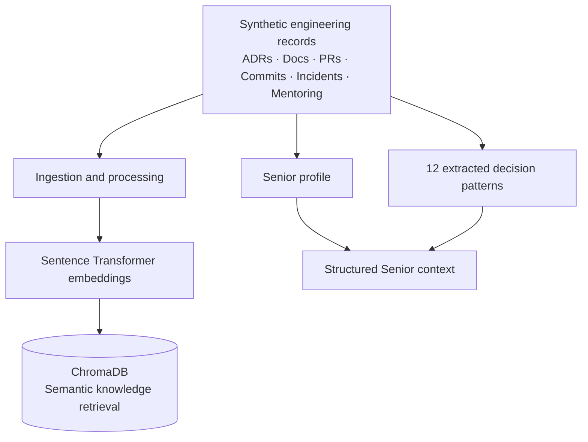

The records provide the evidence base. The profile and decision patterns provide reusable context about the Senior Engineer's documented priorities and decision-making approach.

### 2.2 Generating an Answer

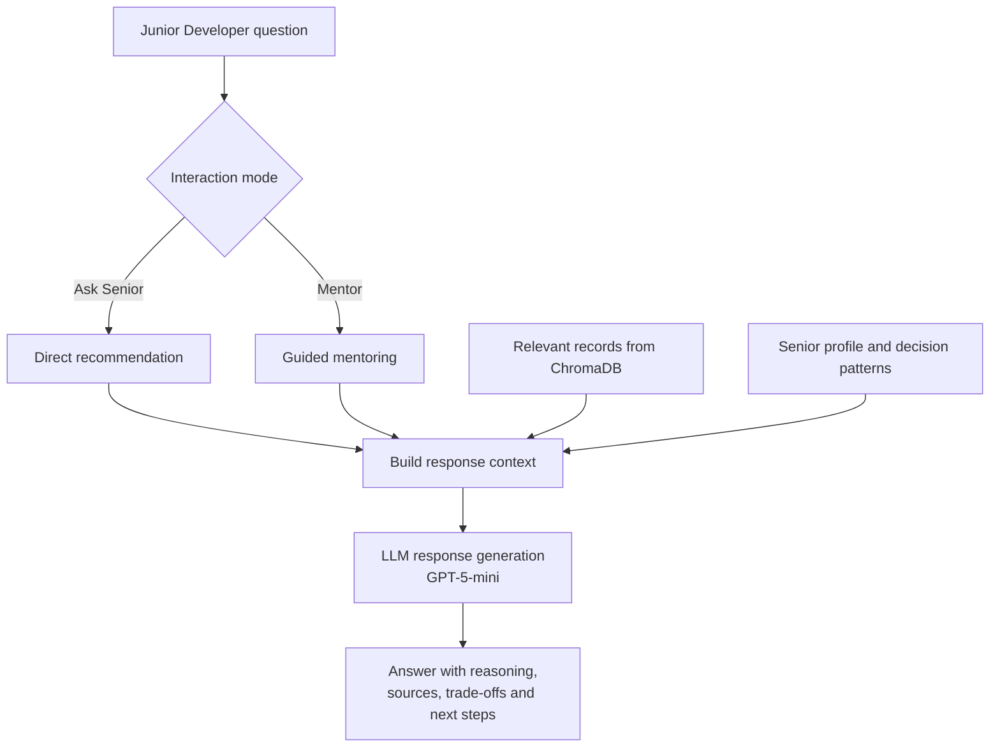

The selected mode changes how the retrieved evidence and Senior context are used:

- **Ask Senior:** prioritizes a direct, practical recommendation.
- **Mentor:** prioritizes guided reasoning and progressive hints.
- **Both modes:** can use retrieved records and the same documented Senior profile.

### 2.3 Traditional RAG vs. My Legacy Mentor

| Capability | Traditional RAG | My Legacy Mentor |
|---|---|---|
| Retrieve relevant documents | Yes | Yes |
| Ground answers in retrieved records | Yes | Yes |
| Represent a specific Senior Engineer persona | Not inherent | Yes |
| Use extracted engineering decision patterns | Not inherent | Yes |
| Apply documented engineering preferences | Not inherent | Yes |
| Provide distinct Ask and Mentor behaviors | Not inherent | Yes |
| Connect new questions to historical decisions | Possible, but not persona-specific by default | Core design goal |

**The distinction is the combination of retrieval, persona context, decision patterns, and mentoring behavior—not a claim that a new foundation model has been trained.**

## 3. Key Features

### Ask Senior

Ask technical questions and receive recommendations informed by the Senior Engineer's documented experience.

### Mentor Mode

Receive incremental guidance, diagnostic questions, and contextual hints designed to encourage independent technical reasoning.

### Source-Grounded Responses

Answers include references to retrieved engineering records, such as architecture decisions, pull requests, incidents, and mentoring examples.

### Senior Engineer Persona

The application incorporates a structured representation of the Senior's professional engineering approach and preferences.

### Decision Pattern Modeling

Recurring engineering principles connect historical decisions to new technical scenarios.

### Document Upload and Ingestion

Upload technical documents to extend the knowledge base.

Supported formats:

- `.txt`
- `.md`
- `.pdf`

The upload API accepts files up to 5 MB.

Uploaded documents are processed through the ingestion pipeline, and their status can be tracked.

### Conversation History

Conversations and messages are persisted using SQLite.

### Persistent Knowledge Base

ChromaDB stores embedded engineering knowledge for semantic retrieval.

### OpenAI Integration

The application uses the OpenAI API with **GPT-5-mini** for generating technical recommendations, contextual explanations, and mentoring responses.

---

## 4. System Architecture

My Legacy Mentor uses a modular Python architecture.

```text
+----------------------------------------------------+
|                  Streamlit Frontend                |
|                    Port 8501                       |
+-------------------------+--------------------------+
                          |
                          | REST API
                          v
+----------------------------------------------------+
|                   FastAPI Backend                  |
|                    Port 8000                       |
|                                                    |
|  - Chat API                                        |
|  - Conversation Management                         |
|  - Document Upload                                 |
|  - Document Status                                 |
|  - SQLite Persistence                              |
+-------------------------+--------------------------+
                          |
                          v
+----------------------------------------------------+
|                   AI / RAG Module                  |
|                                                    |
|  - Knowledge Retrieval                             |
|  - Senior Persona Context                          |
|  - Decision Patterns                               |
|  - Ask / Mentor Behavior                           |
|  - LLM Prompt Construction                         |
+----------------------+-----------------------------+
                       |
              +--------+--------+
              |                 |
              v                 v
     +----------------+  +--------------------+
     |    ChromaDB    |  |     OpenAI API     |
     |                |  |                    |
     | Vector Storage |  |     GPT-5-mini     |
     | Semantic Search|  | Response Generation|
     +----------------+  +--------------------+
```

### Request Flow

```text
Streamlit
    |
    v
FastAPI Backend
    |
    v
AI RAG Pipeline
    |
    +--> Retrieve relevant engineering knowledge
    |
    +--> Incorporate Senior persona and decision patterns
    |
    +--> Apply Ask or Mentor behavior
    |
    v
OpenAI GPT-5-mini
    |
    v
Generated Answer + Supporting Sources
    |
    v
FastAPI Backend
    |
    v
Streamlit
```

The AI module is called directly by the FastAPI Backend.

The architecture does not require a separate AI microservice.

---

## 5. Technology Stack

| Component | Technology |
|---|---|
| Programming Language | Python 3.11 |
| Backend | FastAPI |
| Data Validation | Pydantic v2 |
| Frontend | Streamlit |
| Relational Database | SQLite |
| Vector Database | ChromaDB |
| Embeddings | Sentence Transformers |
| LLM Provider | OpenAI |
| Generation Model | GPT-5-mini |
| HTTP Communication | HTTPX / Requests |
| Deployment | Docker Compose |
| Testing | Pytest |

### AI Processing

The system uses Sentence Transformers for local document and query embeddings.

ChromaDB stores the embedded knowledge and performs semantic retrieval.

Retrieved engineering context, Senior persona information, and interaction-mode instructions are used to construct prompts for GPT-5-mini.

The OpenAI API generates the final responses.

**The application does not require fine-tuning or training a new foundation model.**

---

## 6. Project Structure

The main repository components are:

```text
my-legacy-mentor-hualtf4/
|
+-- ai/
|   +-- ingestion.py
|   +-- retrieval.py
|   +-- rag_pipeline.py
|   +-- llm_client.py
|   +-- ...
|
+-- backend/
|   +-- app/
|   |   +-- main.py
|   |   +-- routers/
|   |   +-- services/
|   |   +-- repositories/
|   |   +-- ...
|   |
|   +-- tests/
|   +-- requirements.txt
|   +-- Dockerfile
|
+-- frontend/
|   +-- app.py
|   +-- api/
|   +-- tests/
|   +-- requirements.txt
|   +-- Dockerfile
|
+-- docker-compose.yml
+-- .env.example
+-- README.md
```

The source code is organized around four responsibilities:

- AI and knowledge processing
- Backend APIs and persistence
- Frontend user experience
- Deployment and infrastructure

---

## 7. Quick Start — Docker Compose

Docker Compose is the recommended deployment method for the hackathon demonstration.

### Prerequisites

- Docker Engine
- Docker Compose
- Internet connection
- Valid OpenAI API key
- Sufficient memory and disk space for Docker images, dependencies, and embedding models

### Step 1 — Clone the Repository

```bash
git clone https://gitlab.com/hualtf4-hackathon-2026/my-legacy-mentor-hualtf4.git

cd my-legacy-mentor-hualtf4
```

### Step 2 — Create the Environment File

On Linux:

```bash
cp .env.example .env
```

On Windows PowerShell:

```powershell
Copy-Item .env.example .env
```

Open `.env` and configure the OpenAI credentials:

```dotenv
LLM_API_KEY=YOUR_OPENAI_API_KEY
LLM_MODEL=gpt-5-mini
LLM_BASE_URL=https://api.openai.com/v1
```

Keep the remaining Backend configuration from `.env.example`.

**Never commit a real API key.**

### Step 3 — Validate Docker Compose

```bash
docker compose config --quiet
```

### Step 4 — Build and Start the Application

```bash
docker compose up --build -d
```

The initial build may download Python dependencies and embedding model files.

### Step 5 — Check Container Status

```bash
docker compose ps
```

### Step 6 — Open the Application

**Streamlit Frontend**

http://localhost:8501

**FastAPI Documentation**

http://localhost:8000/docs

**Backend Health Endpoint**

http://localhost:8000/health

### Docker Services

The Docker Compose configuration defines three services:

| Service | Responsibility |
|---|---|
| `ai-init` | Initialize the ChromaDB knowledge base |
| `backend` | FastAPI, persistence, AI integration, document processing |
| `frontend` | Streamlit user interface |

### Automatic AI Initialization

The `ai-init` service checks whether the ChromaDB collection `senior_knowledge` already contains data.

If the collection is missing or empty, it executes the ingestion process:

```bash
python -m ai.ingestion
```

The Backend depends on successful AI initialization.

The Frontend depends on the Backend health check.

### Persistent Storage

Docker Compose defines persistent volumes for:

- SQLite database and uploaded documents
- ChromaDB vector data
- Downloaded AI model cache

These volumes preserve application data between ordinary container restarts.

### Stop the Application

```bash
docker compose down
```

### Restart the Application

```bash
docker compose up -d
```

### View Logs

```bash
docker compose logs --tail=100 ai-init

docker compose logs --tail=100 backend

docker compose logs --tail=100 frontend
```

### Rebuild After Code Changes

```bash
docker compose up --build -d
```

**Important:** Avoid `docker compose down -v` unless you intentionally want to delete persistent application volumes.

---

## 8. OpenAI Configuration

My Legacy Mentor uses OpenAI GPT-5-mini for generating knowledge-grounded technical recommendations and mentoring responses.

### Environment Variables

| Variable | Description |
|---|---|
| `LLM_API_KEY` | OpenAI authentication key |
| `LLM_MODEL` | Model used for response generation |
| `LLM_BASE_URL` | OpenAI API base URL |

Recommended configuration:

```dotenv
LLM_API_KEY=YOUR_OPENAI_API_KEY
LLM_MODEL=gpt-5-mini
LLM_BASE_URL=https://api.openai.com/v1
```

### AI Responsibilities

**GPT-5-mini**

Generates technical explanations, recommendations, and mentoring responses.

**Sentence Transformers**

Creates vector embeddings for engineering documents and user queries.

**ChromaDB**

Stores and retrieves relevant knowledge.

**Senior Persona and Decision Patterns**

Provide documented professional context and recurring engineering principles.

**RAG Pipeline**

Combines retrieved engineering evidence with Senior-specific context before generating the response.

The current embedding pipeline uses Sentence Transformers rather than an external embedding API.

---

## 9. Local Development Without Docker

The application can also run directly with Python.

This is useful during development or on machines with limited disk space.

### Requirements

- Python 3.11
- Git
- Internet connection
- Valid OpenAI API key

The following commands use Windows PowerShell.

### Step 1 — Clone the Repository

```powershell
git clone https://gitlab.com/hualtf4-hackathon-2026/my-legacy-mentor-hualtf4.git

cd my-legacy-mentor-hualtf4
```

### Step 2 — Create a Virtual Environment

```powershell
py -3.11 -m venv .venv

.\.venv\Scripts\Activate.ps1
```

### Step 3 — Install Dependencies

```powershell
python -m pip install -r backend\requirements.txt

python -m pip install -r frontend\requirements.txt
```

### Step 4 — Configure OpenAI

```powershell
Copy-Item .env.example .env

notepad .env
```

Configure:

```dotenv
LLM_API_KEY=YOUR_OPENAI_API_KEY
LLM_MODEL=gpt-5-mini
LLM_BASE_URL=https://api.openai.com/v1
```

### Step 5 — Configure Local Paths

The `.env.example` includes paths intended for Docker containers.

For local Windows execution, set the corresponding data paths to Windows-compatible locations.

From the repository root:

```powershell
$env:PYTHONPATH = (Get-Location).Path

$env:DATABASE_PATH = Join-Path (Get-Location).Path "backend\data\knowledge_legacy.db"

$env:UPLOAD_DIR = Join-Path (Get-Location).Path "backend\data\uploads"

New-Item -ItemType Directory -Force backend\data\uploads | Out-Null
```

Use the same data paths when starting the Backend.

### Step 6 — Initialize ChromaDB

```powershell
python -m ai.ingestion
```

This initializes the synthetic engineering knowledge base.

Initial execution may download a Sentence Transformers model.

Ingestion and retrieval must use the same persistent ChromaDB storage directory.

### Step 7 — Start FastAPI

In Terminal 1, from the repository root:

```powershell
$env:PYTHONPATH = (Get-Location).Path

cd backend

python -m uvicorn app.main:app --reload --port 8000
```

Keep this terminal running.

Open:

http://localhost:8000/docs

### Step 8 — Start Streamlit

Open Terminal 2 in the repository root:

```powershell
.\.venv\Scripts\Activate.ps1

$env:BACKEND_URL = "http://localhost:8000"

python -m streamlit run frontend\app.py --server.port 8501
```

Open:

http://localhost:8501

The Streamlit frontend communicates with the locally running FastAPI Backend.

---

## 10. REST API

The Backend exposes REST endpoints for conversations, AI chat, document uploads, and system health.

Interactive API documentation is available at:

http://localhost:8000/docs

### Health Check

```http
GET /health
```

### Ask / Mentor Chat

```http
POST /chat
```

Example request:

```json
{
  "question": "Why should database indexes be reviewed before adding new ones?",
  "mode": "ask"
}
```

Example response structure:

```json
{
  "answer": "Technical recommendation based on the Senior Engineer's documented experience...",
  "mode": "ask",
  "sources": [
    {
      "source_id": "ADR-001",
      "title": "ADR: Order lookup latency",
      "type": "architecture_decision"
    }
  ]
}
```

### Mentor Request

```json
{
  "question": "How should I investigate a slow database query?",
  "mode": "mentor"
}
```

The `mentor` mode is designed to provide guided engineering reasoning rather than immediately presenting a complete solution.

### Conversations

```http
POST /conversations
GET /conversations
GET /conversations/{id}
```

The Backend persists conversations and messages using SQLite.

### Document Management

```http
POST /documents
GET /documents/{id}
```

Supported document formats:

- `.txt`
- `.md`
- `.pdf`

Maximum upload size: **5 MB**.

### Document Processing Status

Documents can transition through the following states:

```text
uploaded
   |
   v
processing
   |
   +----> ready
   |
   +----> failed
```

Successfully processed documents become available for knowledge retrieval.

---

## 11. Usage Examples

### Example 1 — Ask Senior

**Question**

> Why should database indexes be reviewed before adding new ones?

My Legacy Mentor can refer to historical database performance investigations, explain index trade-offs, and recommend measuring query execution plans before making schema changes.

Supporting references may include:

- Architecture decisions
- Pull request reviews
- Incident records
- Mentoring examples

### Example 2 — Mentor Mode

**Question**

> I'm a junior developer. How should I investigate a slow database query before adding an index?

Instead of immediately recommending an index, the Digital Twin may begin by asking:

> What does the query execution plan tell us about how the database is accessing the data?

It can then provide hints about `EXPLAIN QUERY PLAN`, representative workloads, and measuring query latency.

### Example 3 — Learning from Previous Decisions

**Question**

> Should we migrate our database because one query is slow?

The Digital Twin can relate the question to documented engineering precedents and explain why a targeted, measured improvement might be preferable to an immediate architectural migration.

---

## 12. Testing

### Backend Unit and API Tests

From the repository root:

```powershell
$env:PYTHONPATH = (Get-Location).Path

cd backend

python -m pytest tests -q
```

The Backend test suite has achieved **71 passing tests** during local development.

### Ask Mode API Test

With the Backend running:

```powershell
$body = @{
    question = "Why should database indexes be reviewed before adding new ones?"
    mode = "ask"
} | ConvertTo-Json

$response = Invoke-RestMethod `
    -Uri "http://localhost:8000/chat" `
    -Method Post `
    -ContentType "application/json" `
    -Body $body

$response.mode

$response.answer

$response.sources | Format-Table
```

### Mentor Mode API Test

```powershell
$body = @{
    question = "I'm a junior developer. How should I investigate a slow database query?"
    mode = "mentor"
} | ConvertTo-Json

$response = Invoke-RestMethod `
    -Uri "http://localhost:8000/chat" `
    -Method Post `
    -ContentType "application/json" `
    -Body $body

$response.mode

$response.answer

$response.sources | Format-Table
```

### End-to-End Functional Testing

The application supports end-to-end testing through Streamlit and FastAPI.

The main testing scenarios are:

- Frontend startup and Backend connectivity
- Ask Mode and grounded technical answers
- Mentor Mode and guided reasoning
- Display of source references
- Conversation creation and retrieval
- Document upload and processing
- Retrieval of newly uploaded knowledge
- API error handling
- Persistent storage
- Docker Compose startup

---

## 13. Evaluation and Results

We compared three configurations on the same **20-question answer-quality evaluation**:

1. **Plain LLM** — the language model without the project's retrieved Senior knowledge.
2. **Baseline RAG** — retrieval-augmented answers using the knowledge base.
3. **My Legacy Mentor** — retrieval combined with the Senior persona, decision patterns, and Ask/Mentor behavior.

The questions covered five categories, with four questions per category: **Known, Adaptation, Composite, Unknown, and Adversarial**.

### 13.1 Answer Quality Score

Answers were assessed using six dimensions, each scored from 0 to 5:

- Correctness and grounding
- Reasoning and explanation
- Completeness
- Actionability
- Uncertainty and risk handling
- Clarity and appropriate detail

The category results were reported as a normalized **Technical Answer Quality Score (TAQS)** on a 0–100 scale.

#### Overall TAQS Comparison

The same high-contrast, color-blind-conscious palette is used in all three charts: **Gray = Plain LLM**, **Blue = Baseline RAG**, and **Vermilion = My Legacy Mentor**.\n\nEach system is shown in its own chart so that no series can cover another. All three use the same 0–100 scale.

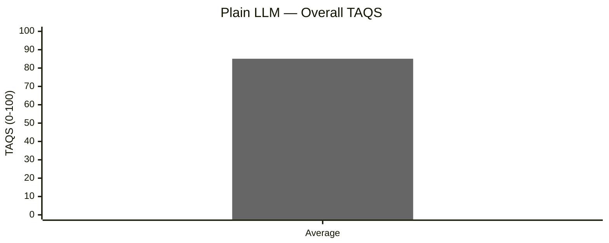

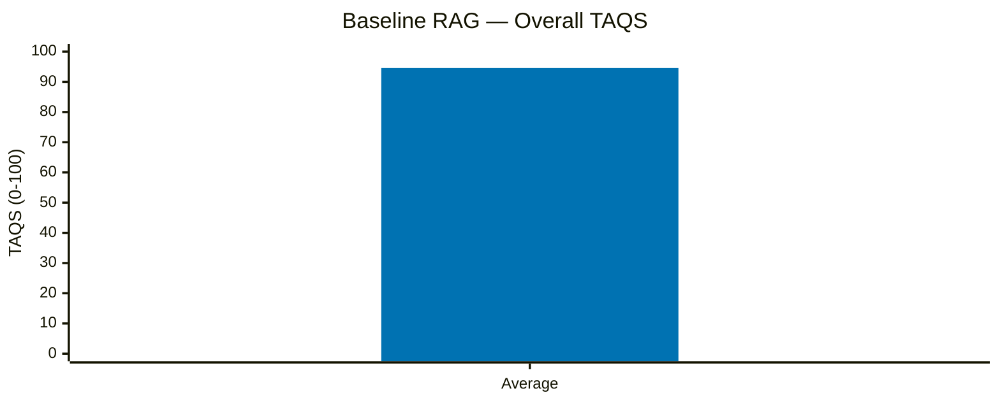

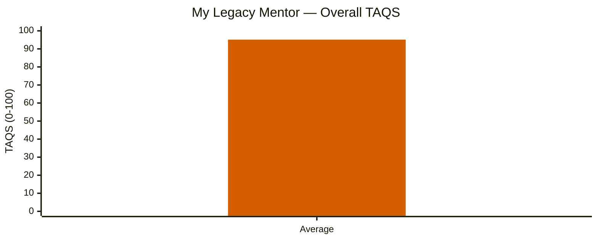

My Legacy Mentor leads Baseline RAG by **0.56 points** and Plain LLM by **10.04 points**.

#### TAQS by Category

| Category | Plain LLM | Baseline RAG | My Legacy Mentor |
|---|---:|---:|---:|
| Known | 69.8 | 93.3 | **95.5** |
| Adaptation | 82.8 | 95.1 | **98.0** |
| Composite | 85.6 | **94.4** | 92.8 |
| Unknown | **94.6** | 94.4 | 92.7 |
| Adversarial | 92.6 | 95.6 | **96.6** |
| **Average** | **85.08** | **94.56** | **95.12** |

Each system has a separate chart with the same five categories and the same 0–100 scale. This makes the values directly comparable without one series hiding another.

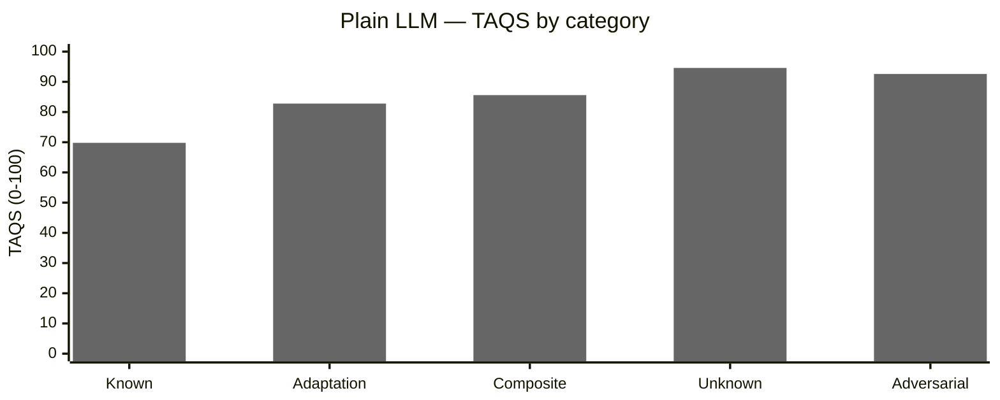

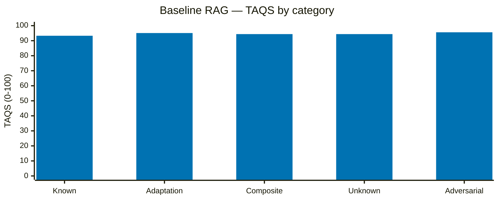

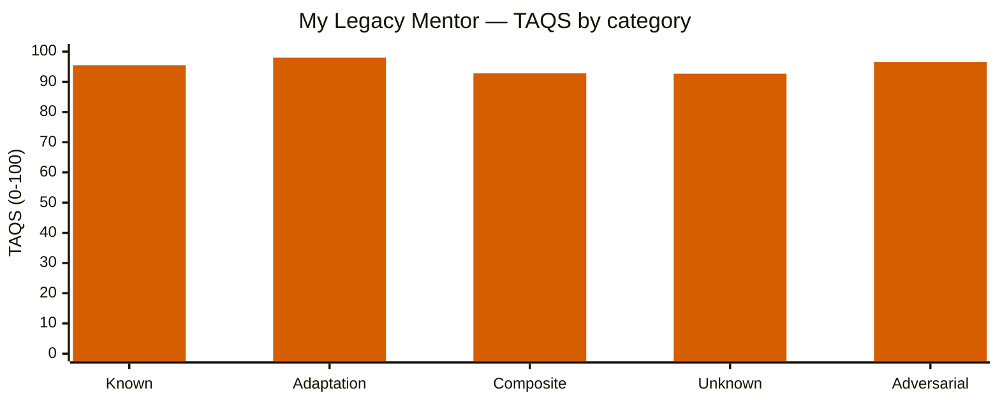

<details>
<summary><strong>What the category results show</strong></summary>

- My Legacy Mentor achieved the highest average TAQS: **95.12/100**.
- It scored higher than Baseline RAG in **3 of the 5 categories**: Known, Adaptation, and Adversarial.
- Its largest category lead over Baseline RAG was in Adaptation: **+2.9 points**.
- Baseline RAG performed better in Composite and Unknown questions.

</details>

#### Detailed Answer Quality (0–5)

| Dimension | Plain LLM | Baseline RAG | My Legacy Mentor |
|---|---:|---:|---:|
| Correctness & Grounding | 3.82 | **4.97** | 4.93 |
| Reasoning & Explanation | 4.38 | 4.64 | **4.69** |
| Completeness | 4.41 | 4.65 | **4.74** |
| Actionability | 4.50 | 4.60 | **4.68** |
| Uncertainty & Risk | 4.56 | 4.65 | **4.77** |
| Clarity & Appropriate Detail | 4.35 | **4.50** | 4.35 |

Each system has a separate chart using the same six dimensions and the same 0–5 scale. This keeps every bar visible and makes the scores directly comparable.

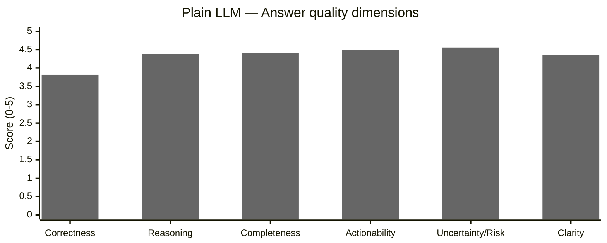

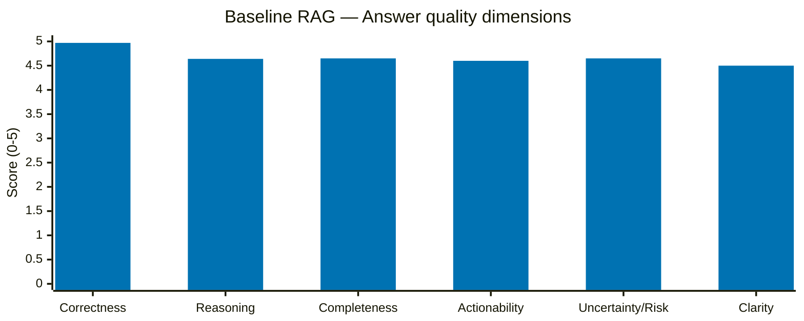

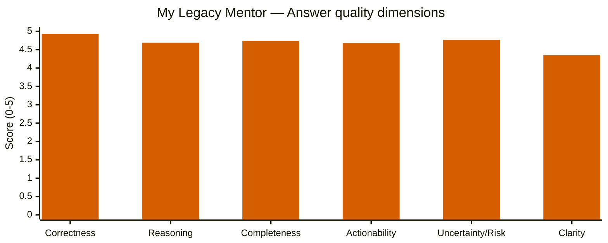

My Legacy Mentor achieved the highest score in **4 of the 6 dimensions**: reasoning, completeness, actionability, and uncertainty/risk handling.

Its average across the six displayed dimensions is approximately **4.69/5**.

### 13.2 What We Can Conclude

The measured overall difference between My Legacy Mentor and Baseline RAG is **+0.56 TAQS points** (95.12 vs. 94.56). This is a modest improvement, not evidence that the Digital Twin is better in every situation.

The more specific positive signal is in the dimensions most closely related to the Digital Twin's purpose: it scored higher than Baseline RAG in reasoning, completeness, actionability, and uncertainty/risk handling. It also performed better in Adaptation and Adversarial categories.

The results therefore support a focused claim:

> **My Legacy Mentor combines the grounding of RAG with documented Senior-specific reasoning and mentoring context, and the 20-question evaluation shows a small overall answer-quality improvement over the Baseline RAG configuration, with stronger scores in four of six reasoning and response-quality dimensions.**

### 13.3 Evaluation Scope

These results should be interpreted in context:

- The evaluation contains **20 questions**, so it is a small sample.
- The knowledge base is synthetic and represents one fictional Senior Engineer.
- Baseline RAG remains stronger in correctness/grounding and clarity in the displayed dimension scores.
- The results are directional evidence from the project's rubric-based comparison; they do not establish statistical significance or guarantee performance on every real-world engineering question.

We present the results transparently rather than claiming that My Legacy Mentor wins every metric.

### 13.4 Synthetic Knowledge Base

The project's synthetic knowledge foundation contains **72 structured engineering records**.

| Knowledge Type | Records |
|---|---:|
| Mentoring examples | 16 |
| Technical documents | 12 |
| Architecture decisions | 12 |
| Pull requests | 12 |
| Incidents | 10 |
| Commits | 10 |
| **Total** | **72** |

The knowledge base is complemented by:

- One structured Senior Engineer profile
- **12 extracted engineering decision patterns**
- Historical engineering decisions and their context
- Documented technical reasoning and trade-offs
- Mentoring principles and examples

These elements provide the evidence and behavioral context used by the Digital Twin when responding to new technical questions.

## 14. Troubleshooting

### Docker Command Not Found

Ensure Docker Engine and Docker Compose are installed and available in the system PATH.

### Docker Engine Not Running

Verify that Docker Engine is running.

On Windows, check WSL 2 and hardware virtualization if using Docker Desktop.

### ChromaDB Collection Missing

Example:

```text
Collection [senior_knowledge] does not exist
```

Initialize the knowledge base:

```bash
python -m ai.ingestion
```

Make sure ingestion and retrieval use the same persistent ChromaDB path.

### AI Service Returns HTTP 503

The Backend may return:

```json
{
  "detail": "AI service is temporarily unavailable"
}
```

Possible causes include:

- Missing ChromaDB knowledge collection
- Invalid OpenAI credentials
- Unsupported LLM request parameters
- Model access restrictions
- Network connectivity issues
- AI dependency or initialization errors

Inspect Backend logs to identify the underlying error.

### OpenAI API Returns HTTP 400

Check the model name and request parameters.

For GPT-5-mini, the current LLM request should avoid unsupported sampling parameters such as a non-default `temperature`.

### Missing Python Dependencies

Install the declared dependencies:

```powershell
python -m pip install -r backend\requirements.txt

python -m pip install -r frontend\requirements.txt
```

### Python Cannot Find the Backend App

Example:

```text
ModuleNotFoundError: No module named 'app'
```

Run the Backend commands from the `backend/` directory.

Set `PYTHONPATH` to the repository root so the AI module can also be imported.

### Document Upload Fails

Check:

- File format
- File size
- Backend availability
- Upload storage path
- Document ingestion logs

Supported file formats are `.txt`, `.md`, and `.pdf`.

---

## 15. Security and Data Privacy

My Legacy Mentor uses synthetic engineering records for demonstration.

The system does not require real employee personal data.

Security principles include:

- Never commit OpenAI API keys.
- Store credentials in a local `.env` file.
- Keep `.env` files outside version control.
- Do not upload confidential company documents without authorization.
- Avoid storing real personal information.
- Do not expose credentials in screenshots or logs.
- Use only authorized data for AI processing.

Relevant retrieved knowledge may be included in prompts sent to the configured OpenAI API.

Only approved, non-sensitive information should be used.

---

## 16. Team Responsibilities

My Legacy Mentor was developed by **Team HuAltF4**, consisting of four developers.

| Member | Responsibility |
|---|---|
| A — AI / RAG / Data | Synthetic knowledge base, ingestion, embeddings, retrieval, persona modeling, decision patterns, LLM integration, AI evaluation |
| B — Backend | FastAPI endpoints, Pydantic schemas, SQLite, document uploads, conversations, Backend–AI integration, API testing |
| C — Docker / DevOps | Dockerfiles, Docker Compose, persistent storage, environment configuration, deployment, documentation |
| D — UI / Checks | Streamlit frontend, Backend API integration, functional checks, end-to-end testing, demo preparation |

---

## 17. Project Vision

My Legacy Mentor explores how organizations can preserve three forms of engineering expertise.

### Technical Knowledge

What experienced engineers know.

### Decision Knowledge

Why experienced engineers choose particular technical approaches, evaluate alternatives, and manage engineering trade-offs.

### Mentoring Knowledge

How experienced engineers guide junior developers toward better technical decisions.

Together, these capabilities form the foundation of an AI Senior Digital Twin.

The objective is not to replace experienced engineers.

It is to make their documented experience, reasoning principles, and mentoring knowledge accessible and reusable.

The application provides an interactive environment where junior developers can ask questions, explore historical decisions, understand technical trade-offs, and develop stronger engineering judgment.

---

### My Legacy Mentor

**Preserving not just knowledge, but engineering judgment.**

*Netcompany Hackathon Athens 2026 — Team HuAltF4*
